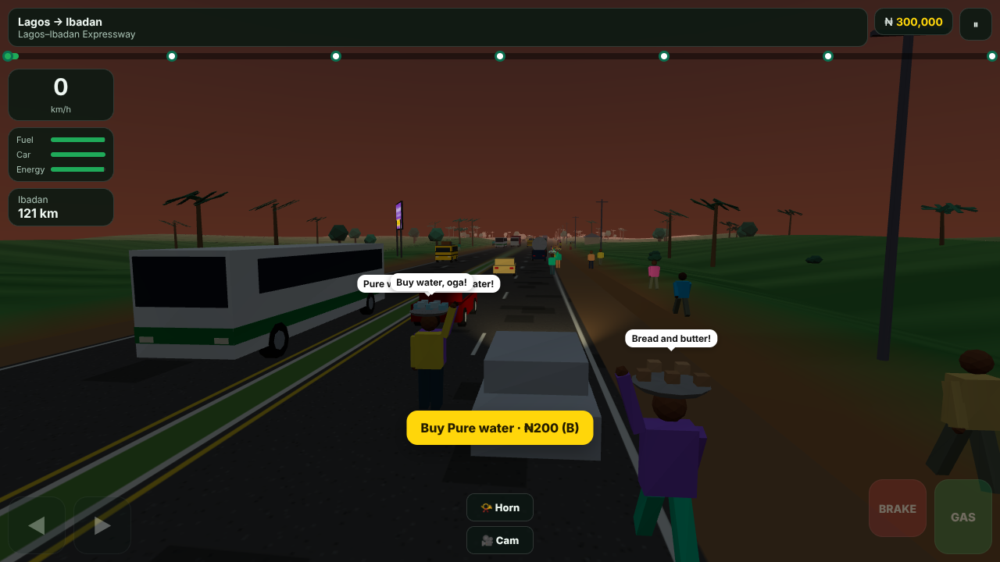
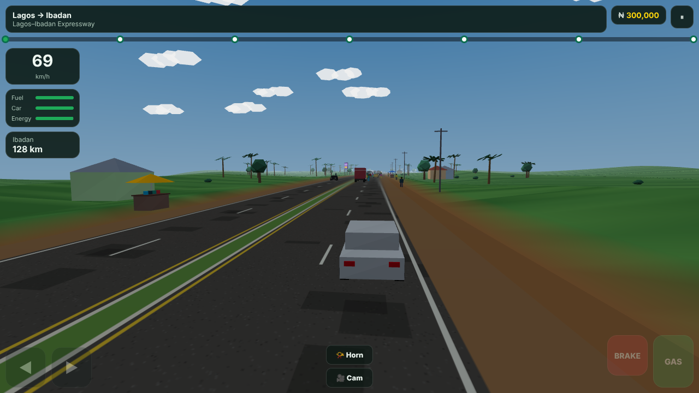
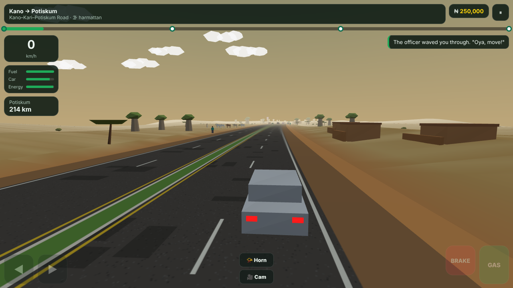
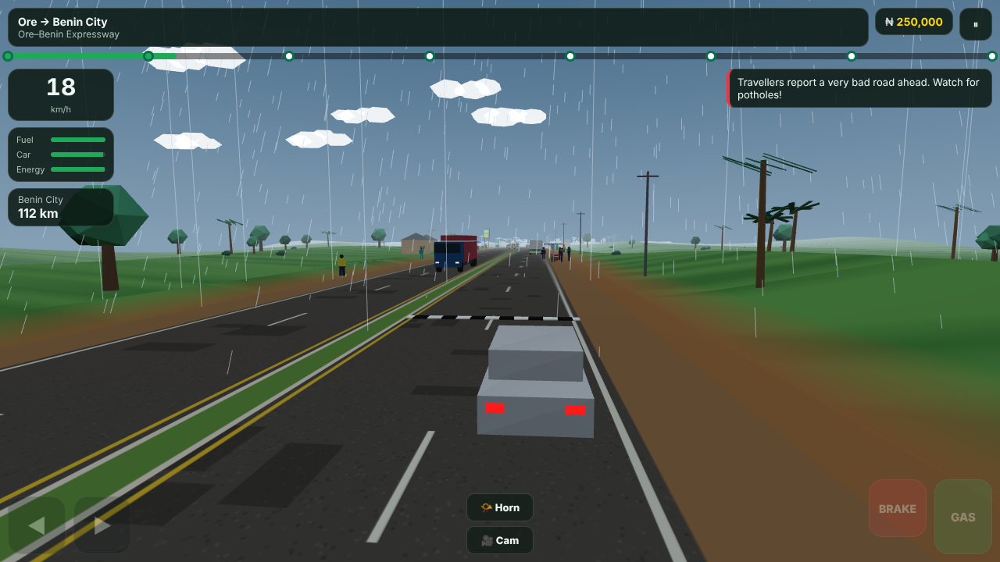

# GreenRev Roadtrip

**A 3D Nigerian road-trip game connecting everyday driving adventures with the GreenRev ecosystem.**

**Version:** v3  
**Language:** TypeScript  
**Integration targets:** Next.js, Node.js, React and mobile WebViews

GreenRev Roadtrip takes players across Nigerian cities, highways and regional landscapes. Players navigate traffic, potholes, checkpoints, roadside stops and changing weather while managing their vehicle, driver energy, journey contracts and in-game money.

The game introduces GreenRev services through relevant moments in the journey: a breakdown can lead to mechanics, missing safety equipment can lead to parts vendors, and a featured dealer vehicle can lead to its marketplace listing.

Daily missions, changing road conditions, unlockable journeys, referrals and challenges are designed to encourage repeat play and measurable visits to the GreenRev web and mobile applications.

> In-game money, loans, fines, compensation and driving thresholds are simulation rules. They are not real banking products, cash payouts or a statement of official road regulations.

## Contents

- [Version 3 highlights](#version-3-highlights)
- [Journeys and regions](#journeys-and-regions)
- [Driving and road events](#driving-and-road-events)
- [Controls](#controls)
- [Daily engagement and progression](#daily-engagement-and-progression)
- [Contracts and the in-game economy](#contracts-and-the-in-game-economy)
- [Audio and radio](#audio-and-radio)
- [Featured dealer vehicles](#featured-dealer-vehicles)
- [Referrals and challenges](#referrals-and-challenges)
- [GreenRev service journeys](#greenrev-service-journeys)
- [Roadside advertising](#roadside-advertising)
- [Run locally](#run-locally)
- [Build and validation commands](#build-and-validation-commands)
- [Embedding and host integration](#embedding-and-host-integration)
- [Saving progress](#saving-progress)
- [Code map](#code-map)
- [TypeScript notes](#typescript-notes)
- [Roadmap](#roadmap)

## Version 3 highlights

| Area | Description |
| --- | --- |
| **TypeScript migration** | A TypeScript codebase intended to fit GreenRev's Next.js frontend and Node.js backend. |
| **Reusable mounting** | `mountRoadtrip(element, config)` for embedding the game, with Next.js client/page/API integration examples. |
| **Backend integration** | Node.js API components for featured listings, referral rewards, credit purchases, cloud saves and GreenRev Points. |
| **Journey contracts** | Passenger, delivery, fragile-cargo and premium pickup jobs, with timed objectives and trip settlement. |
| **Trip finances** | Opening money, earnings, spending by category, net result and journey time. |
| **Difficulty settings** | Easy, Normal and Naija Hard, affecting traffic, hazards, damage, fines, events and pay. |
| **Expanded routes** | Four additional journeys: Lagos–Akure, Lagos–Port Harcourt, Abuja–Enugu and Kano–Sokoto. |
| **Road challenges** | Toll plazas, agberos, road works, floods, one-way drivers, hidden speed bumps and fuel scarcity. |
| **Time and sound** | Time of day, journey timer, daylight arrival bonus, camera views, a two-tone horn and radio/sound controls. |
| **Retention and discovery** | Daily missions, referrals, challenges, achievements, featured dealer cars and contextual GreenRev links. |

Version 3 also improves flyover and overpass ramps, level junctions, roundabout placement, traffic around herds, checkpoint voice timing and default voice settings.

## Journeys and regions

### Available journeys

| Journey | Cities and landmarks | Unlock requirement |
| --- | --- | --- |
| **Lagos → Abuja** | Lagos · Ibadan · Ilorin · Jebba / River Niger · Mokwa · Bida · Abuja | Open |
| **Lagos → Calabar** | Lagos · Ore · Benin City · Onitsha / Second Niger Bridge · Owerri · Aba · Uyo · Calabar | Open |
| **Abuja → Kano** | Abuja · Kaduna · Zaria · Kano | Complete Lagos → Abuja |
| **Abuja → Jos** | Abuja · Keffi · Akwanga · Jos / Plateau climb | Complete Lagos → Abuja |
| **Kano → Maiduguri** | Kano · Potiskum · Damaturu · Maiduguri | Complete Abuja → Kano |
| **Lagos → Akure** | Lagos · Abeokuta · Ibadan · Osogbo · Akure | Open |
| **Lagos → Port Harcourt** | Lagos · Ore · Benin City · Warri · Port Harcourt | Complete Lagos → Calabar |
| **Abuja → Enugu** | Abuja · Lokoja / the Confluence · Anyigba · Enugu | Complete Lagos → Abuja |
| **Kano → Sokoto** | Kano · Katsina · Gusau · Sokoto | Complete Abuja → Kano |

The route set contains **nine journeys and 34 cities**. City arrivals contribute passport stamps, local facts and regional food discoveries.

Each journey leg has its own road quality, traffic level and security/checkpoint profile. City and route definitions are maintained in [`src/data/routes.ts`](src/data/routes.ts).

### Regional scenery

| Region | Scenery and atmosphere |
| --- | --- |
| **South** | Palms, rainforest, creeks and rain. |
| **Middle Belt savanna** | Acacias, savanna and mud compounds. |
| **Sahel** | Harmattan haze, baobabs and northern landscapes. |
| **Jos Plateau** | Hills, climbs and boulders. |

### Gameplay screenshots

The gallery uses files in `docs/screens/`. Include these images when committing the project so they display on GitHub.

| Go-slow and city traffic | Lagos–Ibadan road |
| --- | --- |
|  |  |
| **Sahel and cattle crossing** | **Rain on the Ore–Benin road** |
|  |  |

## Driving and road events

### Traffic and road design

The game includes stylised danfos, kekes, okadas, intercity buses, trailers, tankers and other vehicles. Dual carriageways use right-hand traffic, with a faster lane near the median. Honking can encourage slower traffic to move over.

Road features include:

- The Jebba Bridge and Second Niger Bridge, with river scenery, piers and canoes.
- Smaller southern creek crossings.
- Flyovers, overpasses and traffic passing underneath or above the player's route.
- Roundabouts with traffic wardens, planted islands and monuments.
- Embankments and ramps connecting elevated roads to the surrounding terrain.

Traffic is designed to follow at a safe distance, brake for a stopped player, avoid moving into the player's lane and respond to herds and emergency sirens. Rear-impact handling is intended to avoid unfairly treating every following-vehicle collision as the player's fault.

### Road challenges

| Challenge | In-game behaviour |
| --- | --- |
| **Potholes** | Shallow potholes jolt the car; deep ones can damage it or burst a tyre. Vehicle toughness, suspension and weather affect the experience. |
| **Go-slow** | City and mid-route traffic jams, including broken-down trailers, market activity and road works. |
| **Hawkers** | Roadside sellers move between vehicles; snacks can restore driver energy. |
| **Toll plazas** | Stop and pay; running a barrier can produce a fine and vehicle damage. |
| **Agberos** | Encounters involving a levy, an argument or an appeal to a warden, with different risks. |
| **Road works** | Lane closures, cones and a need to merge in time. |
| **Flooded roads** | Driving too quickly through water can stall the vehicle. The game threshold is 30 km/h. |
| **One-way drivers** | An approaching vehicle in the player's lane creates an avoidance challenge. |
| **Hidden speed bumps** | Unmarked town-entry “gallops” punish excessive speed. |
| **Fuel scarcity** | Some pumps are unavailable, with higher-priced roadside fuel as an alternative. |
| **Cattle and goats** | Herd crossings cause traffic to stop while animals and herders pass. |
| **Patrol vehicles** | Police/FRSC vehicles can react to speeding, activate a siren and request a stop. |

Patrols use 100 km/h as the in-game speeding trigger; ignoring a patrol for 25 seconds can double the in-game fine. Roundabout wardens use a separate 60 km/h game threshold.

### Checkpoints

| Checkpoint | In-game interaction |
| --- | --- |
| **Police** | Vehicle papers and an official-fine/receipt interaction when papers are expired. |
| **Military** | A stop-and-search encounter. |
| **FRSC** | Safety-kit checks for a fire extinguisher, warning triangle and spare tyre. |
| **VIO** | A condition/roadworthiness encounter; the game flags condition below 50%. |
| **Missed stop** | Running a checkpoint leads to a heavier in-game penalty. |

Pedestrians, officers, traders, mechanics, hawkers and herders bring the roads to life. The intended presentation is non-graphic: people move out of the way and respond through dialogue, gestures or speech bubbles.

### Vehicle upkeep and rest stops

Fuel, vehicle condition and driver energy affect a trip. Filling stations, repairs, regional food and rest stops help the player continue.

Rest stops can provide:

- Fuel and regional food.
- A one-hour rest to restore energy.
- A quick mechanic check that restores 15% condition.
- Missing safety-kit items.
- A buka, rest house, parked vehicles and traveller activity.

Food varies by region, including jollof/amala, pounded yam/suya, tuwo/kilishi/fura da nono and Plateau potato dishes.

### Time, weather and cameras

The game uses a day/night cycle, headlights, traffic lights, rain and harmattan effects. Journey time and the job target are shown on the HUD; daylight arrival can earn a bonus.

Seven camera views are available:

1. Chase.
2. Bonnet.
3. Driver/cockpit.
4. Front-facing view looking back at the car.
5. Aerial.
6. Top-down.
7. Cinematic.

Use **C** or the **camera button** to cycle views. The garage also includes 12 paint colours for the player's car.

## Controls

| Input | Action |
| --- | --- |
| **↑ / W** | Accelerate. |
| **↓ / S / Space** | Brake. |
| **← / → / A / D** | Steer. |
| **H** | Sound the horn; also interact with a passing featured car. |
| **C** | Change camera. |
| **B** | Buy from a hawker when available. |
| **F** | Refuel when available. |
| **P / Esc** | Pause. |
| **On-screen controls** | Driving and interaction controls for phones, including the camera button. |

## Daily engagement and progression

| Feature | Purpose |
| --- | --- |
| **Daily streak** | Check-in fuel money grows across a seven-day cycle, then repeats. The defaults range from ₦50,000 to ₦500,000 in game currency; missing a day resets the streak. |
| **Daily missions** | Three missions per day, such as avoiding potholes, buying from hawkers or visiting GreenRev Marketplace. |
| **Daily road variation** | Date-seeded hazards, checkpoints, jams and weather create a new road plan. |
| **Progression** | Unlockable journeys, city passport stamps, XP, best times and 12 achievements. |
| **Garage** | Six vehicles, plus tyres, suspension, engine upgrades and safety equipment. |

The garage includes a Tokunbo Corolla, Honda Accord “Evil Spirit”, Innoson G5, Hilux, Lexus RX 350 and Land Cruiser V8.

## Contracts and the in-game economy

### Journey contracts

Players can accept a job before travelling or choose to drive without one. Daily offers are intended to be consistent for players on the same date.

| Contract | Objective |
| --- | --- |
| **Passenger load** | Earn fares and tips while keeping passengers comfortable. Hard braking, potholes and crashes affect the journey. |
| **Express delivery** | Beat a time target for higher pay; late delivery pays less. |
| **Fragile cargo** | Protect goods such as tomatoes and eggs from road damage. |
| **Chief's pickup** | Complete a careful journey without crashes or fines to retain the larger bonus. |

At arrival, the trip summary shows starting money, earnings, spending by category, net result and journey time.

### Negative balances and the fictional bank

Fines, tolls, levies and roadside repairs can push the game wallet below zero. Fuel and repairs can use a level-dependent overdraft. The negative-wallet charge is 5% per leg, with vehicle purchases and upgrades restricted while the wallet is negative.

**Mama Bisi Microfinance is fictional.** Its game loans have three sizes, interest per leg and automatic repayment from a quarter of each leg's pay. Progress can increase the player's credit limit, and clearing debt contributes to an achievement.

### Difficulty

**Easy**, **Normal** and **Naija Hard** change traffic, hazards, penalties, damage, event frequency and pay. Harder play offers up to 45% additional pay. Difficulty can be changed from the job screen or settings.

### Optional credit purchases

The credit-purchase integration is designed for optional packs starting from ₦500 that add **non-redeemable game currency**. Purchased game currency cannot be cashed out.

Credit purchases require the host application and backend to confirm the transaction and grant it once. Web Paystack checkout and mobile Apple/Google purchase handling require their respective host/provider integrations and configuration.

A client-only or historical test checkout is not a production payment wallet. Review [`src/config.ts`](src/config.ts) and [`server/README.md`](server/README.md) before enabling purchases, including confirmation, duplicate handling and refunds.

## Audio and radio

The HUD provides station switching and a sound panel for music/effects volume, mute, voices and horn testing without pausing the game.

The built-in stations are **GreenRev FM** and **Highlife Hour**, using procedural music. Recorded voice clips and optional text-to-speech provide roadside and checkpoint dialogue. Robot speech is disabled by default.

Voice recording guidance is in [`public/voice/README.md`](public/voice/README.md).

### Add a music playlist

Use music you have permission to distribute or stream. A playlist at `public/music/playlist.json` can use this structure:

```json
{
  "tracks": [
    {
      "title": "Your licensed track",
      "artist": "Your artist",
      "src": "/music/your-licensed-track.mp3"
    }
  ]
}
```

The playlist enables the **Naija Hits** station. Add the actual audio files at the configured paths.

### Configure live streams

Set the configuration before the game loads:

```javascript
window.GREENREV_CONFIG = {
  radio: {
    live: [
      {
        name: "Station FM 100.0",
        url: "https://stream.example.com/live"
      }
    ]
  }
};
```

Use actual HTTPS streams with permission from the station and relevant content owners. Replace the illustrative URL before deployment. Test playback in the deployed application, including the unavailable-station fallback.

Combine required settings into one configuration object when using several of the examples in this README.

## Featured dealer vehicles

Featured vehicles connect the game to GreenRev dealer listings. A stylised vehicle appears on the road, receives a dealer tag and can be hyped through a button, tap or horn interaction.

The discovery loop includes:

- Hype points and game money for reactions.
- A listing card with dealer, city, title and price.
- A **View this car on GreenRev** link.
- A **Save to dream garage** action.
- A pause while the card is open and a **Keep driving** action.
- Arrival-screen and dream-garage access to discovered cars.

Featured models are stylised saloons, SUVs or coupes without brand logos. A real listing title may contain the dealer's own vehicle description.

### Listing configuration

Add entries to `public/featured.json`, or configure `featured.url` to return the same structure from the backend:

```json
{
  "cars": [
    {
      "id": "sample-dealer-saloon-1",
      "dealer": "Sample Dealer",
      "city": "Lagos",
      "title": "Black luxury saloon, 2024",
      "body": "limo",
      "color": "#0d0d0f",
      "price": 185000000,
      "listingUrl": "https://example.com/vehicle-listing",
      "start": "2026-11-01",
      "end": "2026-11-30"
    }
  ]
}
```

This is an illustrative payload, not a live dealer campaign.

| Field | Meaning |
| --- | --- |
| `body` | `limo`, `luxsuv` or `coupe`. |
| `color` | Vehicle colour as a hex value. |
| `price` | Optional listing price. |
| `listingUrl` | Optional real listing link; the fallback searches Marketplace by title. |
| `start` / `end` | Optional campaign dates. |

Sample cars can keep the loop available before real listings are configured; their cards should remain identified as samples. Appearance frequency is controlled by `featured.minGapSeconds` and `featured.maxGapSeconds` in `src/config.ts`.

### Featured-car events

| Event | Example properties |
| --- | --- |
| `hype_car` | `car`, `dealer`, `points` |
| `hype_card_open` | `car`, `reason` |
| `hype_save` | `car` |
| `cta_click` | `target`, `car`, `dealer`, `reason` |

Listing links carry UTM context such as `hype_toast`, `arrival_hyped` and `dream_garage`.

## Referrals and challenges

Players receive a six-character invite code. The menu can share a link through the phone share sheet, WhatsApp or copy action.

| Interaction | Documented behaviour |
| --- | --- |
| **Invite link** | A game URL ending with `#ref-CODE`. |
| **Welcome reward** | A default ₦200,000 in game fuel money for an eligible new player joining through a friend's code; self-referrals do not count. |
| **Journey challenge** | Share a completed journey and target time using a link such as `#ref-CODE-ch-lagos-abuja-t-754`. |
| **Challenge reward** | A default ₦100,000 in game money for an eligible faster result. |

Inviter rewards need backend validation. The host should record referral joins and configure `referral.claimUrl` for reward claims.

The claim request uses `GET ?code=ABC123` and expects a response shaped like:

```json
{
  "reward": 150000,
  "joins": 3
}
```

Referral-related events include `referral_open`, `referral_join`, `invite_share` and `challenge_result`.

For mobile deep links, configure:

```javascript
window.GREENREV_CONFIG = {
  invite: "ref-ABC123",
  playUrl: "https://example.com/roadtrip"
};
```

Replace the example play URL with the public game address.

## GreenRev service journeys

| In-game moment | GreenRev destination |
| --- | --- |
| Breakdown, tyre burst, crash, failed VIO encounter or engine warning | Mechanics; the GreenRev mechanic option includes a 30% in-game discount. |
| Missing safety kit or garage equipment need | Parts vendors. |
| Garage vehicle discovery or a city stop | Marketplace, including a model search where configured. |
| City stop or completed journey | Dealer registration/sign-up. |
| Featured vehicle interaction | The configured dealer listing or Marketplace search. |
| Tapped roadside advertisement | The advertiser's configured destination. |
| Main menu links | Marketplace and dealer sign-up. |

CTA links carry a reason such as `breakdown`, `vio_fail` or `garage_real_car` for funnel reporting. Configure the real GreenRev destination pages in `src/config.ts` before deployment.

## Roadside advertising

Businesses can book in-game roadside billboard placements. **ADVERTISE HERE** boards, rest-stop signs and the menu advertising action lead to the booking panel.

### Default package examples

| Duration | Configurable default price |
| --- | --- |
| 3 days | ₦15,000 |
| 7 days | ₦30,000 |
| 30 days | ₦100,000 |

These prices are configurable defaults. Set the commercial prices, booking terms and payment links before accepting bookings.

### Booking configuration

The booking setup uses one Paystack payment page per package. Add its actual link to `advertise.packages`, or supply the configuration through the host application:

```javascript
window.GREENREV_CONFIG = {
  advertise: {
    contactUrl: "https://example.com/advertise",
    packages: [
      {
        id: "3d",
        days: 3,
        price: 15000,
        paystackUrl: "https://paystack.com/pay/your-3-day-page"
      },
      {
        id: "7d",
        days: 7,
        price: 30000,
        paystackUrl: "https://paystack.com/pay/your-7-day-page"
      },
      {
        id: "30d",
        days: 30,
        price: 100000,
        paystackUrl: "https://paystack.com/pay/your-30-day-page"
      }
    ]
  }
};
```

All example URLs must be replaced with working operator-controlled destinations. Without a package payment link, the button falls back to **Book now** and the configured contact destination.

### Artwork

- **Dimensions:** 1024 × 512 pixels, a 2:1 ratio.
- **Format:** JPG or PNG.
- **File size:** below 500 KB.
- **Safe area:** keep text at least 40 pixels from the edges.
- **Template:** `public/ad-template.png`.

Regenerate the template with:

```bash
node scripts/make-ad-template.mjs
```

### Campaign configuration

Add campaigns to `public/ads.json`, or configure `advertise.adsUrl` to serve the same structure:

```json
{
  "campaigns": [
    {
      "id": "sample-food-campaign",
      "advertiser": "Sample Advertiser",
      "image": "https://example.com/ads/billboard.jpg",
      "link": "https://example.com/advertiser",
      "start": "2026-11-01",
      "end": "2026-11-07",
      "routes": ["lagos-abuja"]
    }
  ]
}
```

The example is illustrative. Route targeting is optional; omitting `routes` makes a campaign eligible across journeys. Serve artwork from a host configured for the game's cross-origin image access.

Active campaigns rotate through advertising slots with an **Ad** label. A tap opens the configured advertiser destination.

### Advertising events

| Event | Purpose |
| --- | --- |
| `ad_impression` | Campaign exposure, with campaign identifier. |
| `ad_click` | Campaign tap/click, with campaign identifier. |
| `advertise_open` | Advertising panel opened. |
| `advertise_package_click` | A package was selected. |

## Run locally

Use the Node.js/npm version required by the repository's `package.json` and a browser with WebGL support. Run commands from the project folder containing `package.json`.

Install dependencies:

```bash
npm install
```

Start the game:

```bash
npm run dev
```

Open the address printed by the development server. The default address is:

[http://localhost:5173](http://localhost:5173)

To run the separate Roadtrip API, open another terminal in the project folder:

```bash
npm run api
```

The local API port is **8787**. See [`server/README.md`](server/README.md) for backend setup and required configuration.

## Build and validation commands

| Command | Purpose |
| --- | --- |
| `npm test` | Unit tests for the economy, contracts, events, routes, referrals and API workflows. |
| `npm run typecheck` | Run the TypeScript checks explicitly. |
| `npm run build` | Build the static game site into `dist/`. |
| `npm run build:lib` | Build the embeddable ES module and CSS into `dist-lib/`. |
| `npm run build:single` | Build a self-contained `dist-single/index.html` for WebView packaging. |
| `npm run smoke` | Headless browser workflow checks, including startup, driving and key roadside interactions. |
| `node scripts/tour.mjs` | Capture regional screenshots into `screenshots/`. |
| `node scripts/features-tour.mjs` | Capture bridge, flyover, overpass and roundabout examples. |
| `node scripts/stops-tour.mjs` | Capture rest stops, advertising boards and the booking panel. |

Run the relevant tests, type checks, production build and browser checks before deployment.

## Embedding and host integration

### Static hosting

Build the site with:

```bash
npm run build
```

Host the generated `dist/` files at the intended public game address, such as a `/roadtrip` route on the GreenRev website.

### Next.js and React

The reusable entry point is:

```typescript
mountRoadtrip(element, config);
```

The `nextjs/` integration includes a client component, page and API route. Follow [`nextjs/README.md`](nextjs/README.md) for its actual imports and mounting instructions, and use `npm run build:lib` for the library output.

### Mobile WebViews and iframes

Build the single-file package with:

```bash
npm run build:single
```

The host app can handle navigation and analytics messages instead of opening external URLs directly.

Example navigation message:

```json
{
  "type": "greenrev:navigate",
  "target": "mechanic",
  "url": "https://example.com/mechanics?utm_source=roadtrip_game",
  "context": {
    "reason": "breakdown",
    "city": "Ibadan"
  }
}
```

Example analytics message:

```json
{
  "type": "greenrev:event",
  "event": "leg_complete",
  "props": {
    "routeId": "lagos-abuja",
    "leg": 1,
    "seconds": 754,
    "crashes": 0
  }
}
```

The bridge supports a React Native WebView through `window.ReactNativeWebView` and an iframe host. Use the host application's validated navigation and message handling.

### Analytics

Core events include:

- `session_start`.
- `daily_checkin`.
- `route_start`.
- `leg_complete`.
- `route_complete`.
- `cta_click`.

When available, `window.GreenRevAnalytics.track(event, props)` also receives events.

## Saving progress

Local progress is saved in the browser under:

```text
greenrev-roadtrip-v2
```

Cross-device progress and GreenRev Points require the host application's GreenRev identity, persistence and cloud-save services. Connect these backend services to enable account-backed progress.

## Code map

| Path | Responsibility |
| --- | --- |
| `src/mount.ts` | Reusable `mountRoadtrip(element, config)` entry point. |
| `src/standalone.ts` | Standalone entry for `index.html`. |
| `src/markup.ts` | Game HTML, canvas, HUD, menu and modal markup. |
| `src/main.ts` | Main driving loop, events, collisions, dialogue and arrivals. |
| `src/config.ts` | Service links, host bridge, purchases, advertising and analytics configuration. |
| `src/types/` | Shared route, leg, modal and global types. |
| `src/data/routes.ts` | Cities, journeys, leg profiles, regional scenery and route settings. |
| `src/data/cars.ts` | Garage vehicles, upgrades, safety kit and driving characteristics. |
| `src/game/state.ts` | Saves, daily streaks, missions and achievements. |
| `src/game/economy.ts` | Trip ledger, overdraft, fictional bank, credit packs and difficulty. |
| `src/game/contracts.ts` | Jobs, target times and settlement. |
| `src/game/director.ts` | Date-seeded road-event plans. |
| `src/game/cloud.ts` | Cloud saves and GreenRev Points integration. |
| `src/game/ads.ts` | Advertising campaign handling. |
| `src/game/featured.ts` | Featured vehicles, hype and dream garage. |
| `src/game/referral.ts` | Invite codes, referral claims and challenge links. |
| `src/game/audio.ts` | Engine, horn, effects and radio. |
| `src/game/voice.ts` | Recorded clips and optional text-to-speech. |
| `src/game/physics.ts` | Lanes, curves, hills, elevated roads and junction alignment. |
| `src/game/ui.ts` | Menus, modals, garage, passport and HUD helpers. |
| `src/world/world.ts` | Streamed terrain, road, sky, scenery and weather. |
| `src/world/traffic.ts` | NPC following, lane changes, herds and road-event traffic. |
| `src/world/actors.ts` | People and animals. |
| `src/world/features.ts` | Bridges, flyovers, overpasses and roundabouts. |
| `src/world/models.ts` | Procedural low-poly models and road-event objects. |
| `server/` | Node.js API handlers, storage interface and server tests. |
| `nextjs/` | Next.js integration examples. |
| `public/featured.json` | Featured vehicle configuration. |
| `public/ads.json` | Advertising campaign configuration. |
| `public/music/playlist.json` | Optional licensed-music playlist. |
| `public/voice/` | Optional recorded dialogue clips and voice guidance. |

## TypeScript notes

The TypeScript v3 migration uses `strict: false` during the transition. Tighten type checking incrementally as modules are reviewed.

Keep `npm run typecheck` as an explicit CI step rather than assuming that bundling also performs the required type checks. Confirm actual compiler settings in the repository before changing them.

The visual style is procedural, low-poly WebGL, intended for mobile-friendly rendering. External artwork, optional audio, advertising images and the configured logo still need their corresponding files or hosted resources.

## Roadmap

Planned improvements include:

- Travel-together invitation links for a shared car or convoy.
- In-trip voice chat.
- Additional luxury and enthusiast vehicles.
- Further vehicle customisation.

See [`docs/ROADMAP.md`](docs/ROADMAP.md) for the repository's maintained roadmap.

## Integration reference

- [Next.js integration](nextjs/README.md)
- [Node.js backend setup](server/README.md)
- [Voice recording guidance](public/voice/README.md)
- [Project roadmap](docs/ROADMAP.md)
- [Game configuration](src/config.ts)
- [Journey definitions](src/data/routes.ts)

This README describes the TypeScript v3 layout. Earlier standalone JavaScript builds used different file layouts; use the current module map and integration documentation when merging the game into the GreenRev applications.
